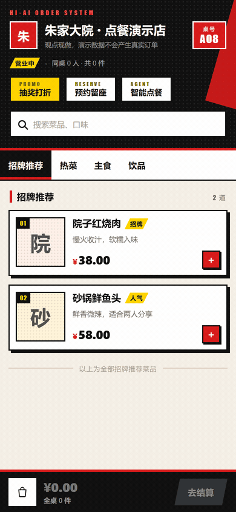
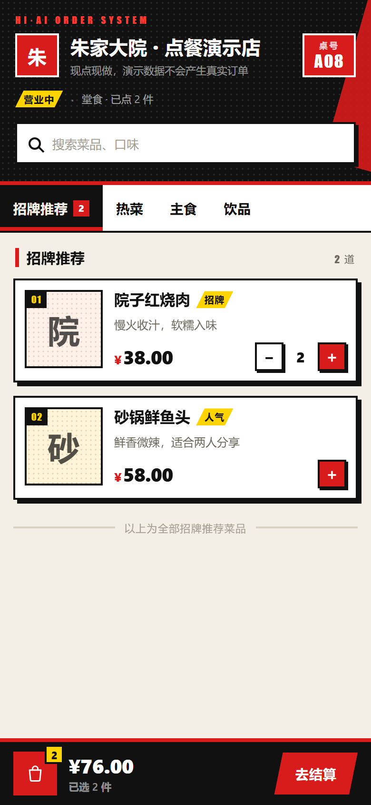
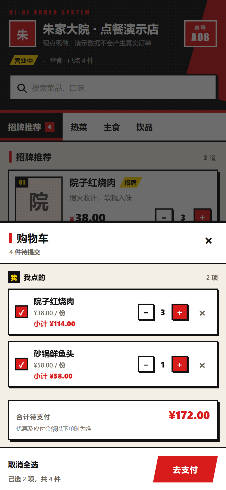
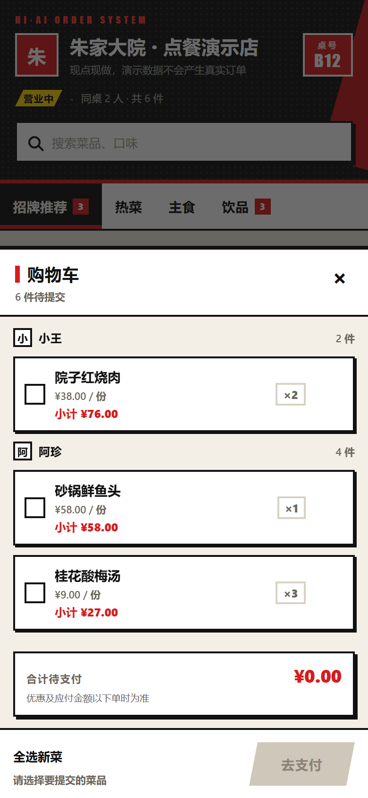
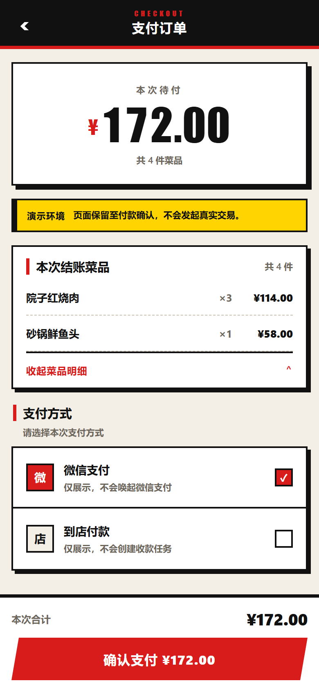
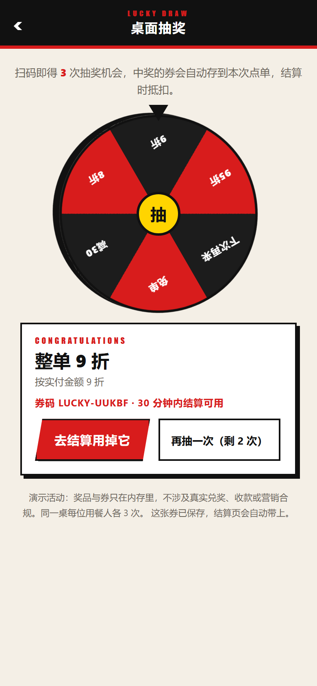
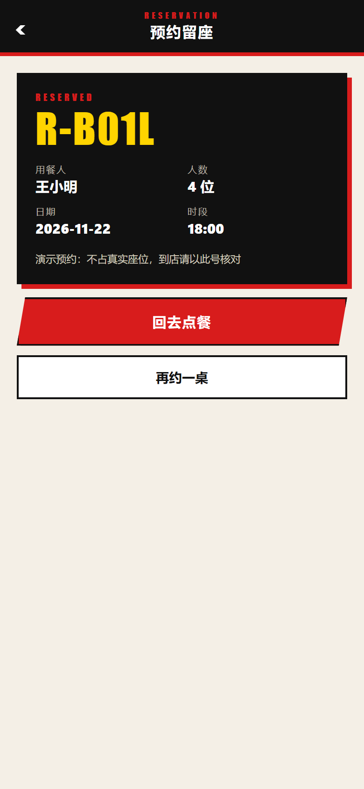
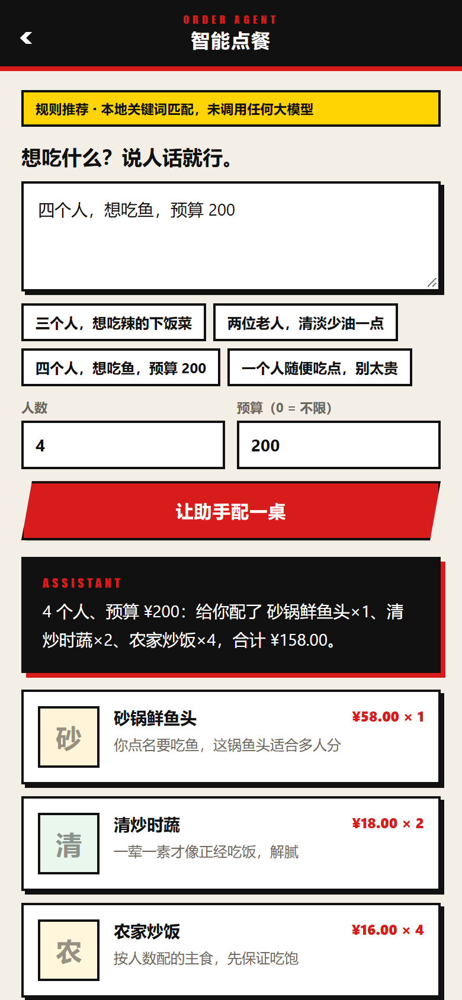

# hiAi 扫码点餐 · 共享购物车 Demo

> 一张桌一个二维码，同桌几个人各自扫码点菜，购物车实时合并，最后由一个人确认结算。
> 这是一个**可完整跑通的演示项目**：不接支付渠道、不落库、不会产生真实订单。

<p align="center">
  
</p>



## 它演示了什么

- **扫码进桌**：链接带桌号（`/?table=A08`），前端把桌号写进请求，同桌所有人共用同一张桌的购物车；
- **共享购物车**：每人只改自己的份数，购物车按人分组展示，每 3 秒同步一次同桌的最新状态；
- **加菜跟手**：加减号是乐观更新 + 按菜品串行合并请求，连点五下也只会发 1~2 个请求，不会有「点一下整页变灰」；
- **后端核算**：结算金额由后端用 `BigDecimal` 重新计算，前端显示的钱和接口算的钱一致；
- **P 系列风格界面**：黑底 + 硬投影 + 红黄撞色，圆角为 0，所有交互都有明确的按下反馈；
- **预约留座**：日期 + 时段 + 人数落到后端，返回一个可查询的预约号（不占真实座位）；
- **抽奖促销**：每人每桌 3 次转盘机会，中奖发券，结算页自动抵扣，券带门槛与 30 分钟有效期；
- **智能点餐（规则版）**：把「几个人 / 想吃什么 / 预算」翻译成一桌菜，每条推荐都给出理由；**这是本地规则匹配，不是大模型**。

<p align="center">
  
  
  
</p>

<p align="center">
  
  
  
</p>

## 三种跑法

### 1. 只想看前端（不需要 Java）

```sh
cd frontend
npm install
npm run dev:full
```

打开 <http://localhost:3000>。`dev:full` 会同时拉起内置假后端（`mock-server.mjs`）和 Vite；
假后端的接口、字段、金额规则与真实 Spring Boot 实现完全一致。

### 2. 完整打包成单个 JAR

环境要求：Java 17、Maven 3.8+、Node.js 20+。

```powershell
.\build.ps1          # Windows
sh ./build.sh        # macOS / Linux
.\run.ps1            # 运行最近一次打包结果
```

访问 <http://localhost:8080>，健康检查 <http://localhost:8080/api/demo/health>。

### 3. Docker（部署到任意云主机）

```sh
docker build -t hiai-menu-cart .
docker run -p 8080:8080 hiai-menu-cart
```

镜像里前端静态资源会打进同一个 JAR，`PORT` 环境变量可直接改端口，适合 Render / Zeabur / Fly.io / 小 VPS。

想直接把它发到线上，照 [docs/deploy.md](docs/deploy.md) 走一遍（Render / Zeabur / VPS 三条路 + 桌贴二维码 + 仓库 About 怎么填）。

## 模拟同桌点餐

1. 浏览器开两个标签页（两个标签页会被当成两个不同的用餐人）；
2. 都访问 <http://localhost:3000/?table=A08>；
3. 一边加菜，另一边 3 秒内就能在购物车里看到对方点的菜，并且只能改自己那份。

## 抽奖 / 预约 / 智能点餐怎么试

- **抽奖**：菜单页点「抽奖打折」→ `/#/lucky`，点一次转盘，中奖后券自动存进本次会话；去结算页能看到「优惠」行和实付金额变化。
- **预约**：菜单页点「预约留座」→ `/#/reserve`，填手机号（11 位）、选日期时段，提交后拿到 `R-XXXX` 预约号，`GET /api/demo/reservations/R-XXXX` 可以查回来。
- **智能点餐**：菜单页点「智能点餐」→ `/#/agent`，选一句快捷话术或自己输入，助手给出菜名、份数、理由和合计，可以一键加进购物车。

> 智能点餐是**规则引擎**：从文本里识别「辣 / 清淡 / 鱼 / 汤 / 饮料 / 人数 / 预算」，再按菜单搭配并解释理由。
> 页面和接口返回里都标了 `规则推荐 · 本地关键词匹配，未调用任何大模型`，接真模型需要另外配置 API key。

## 演示接口

| 方法 | 路径 | 说明 |
| --- | --- | --- |
| GET | `/api/demo/menu` | 菜品、分类与店铺信息 |
| GET | `/api/demo/cart?table=A08&member=m-xxx` | 读取整桌购物车（含每人份数） |
| POST | `/api/demo/cart/items` | 设置「我」在某道菜上的份数，0 表示移除 |
| POST | `/api/demo/checkout/preview` | 后端重新核算并返回结算预览，可带 `couponCode` |
| POST | `/api/demo/promo/draw` | 抽奖发券（每人每桌 3 次，券 30 分钟过期） |
| POST | `/api/demo/reservations` | 创建预约，返回 `R-XXXX` 单号 |
| GET | `/api/demo/reservations/{code}` | 按单号查询预约 |
| POST | `/api/demo/agent/recommend` | 规则推荐一桌菜（带理由与合计） |
| GET | `/api/demo/health` | 运行状态，固定 `paymentEnabled=false` |

`POST /api/demo/cart/items` 请求体：

```json
{ "table": "A08", "member": "m-1234", "memberName": "小王", "dishId": "dish-001", "quantity": 2 }
```

购物车存在内存里（`桌号 → 成员 → 菜品`），重启即清空，不涉及任何数据库。

## 目录

```text
frontend/        Vue 3 + Vite 的移动端 H5，含假后端 mock-server.mjs
backend/         Java 17 + Spring Boot，内存共享购物车
docs/screenshots 界面截图
build.ps1/.sh    前端 dist + 后端一起打成可执行 JAR
Dockerfile       多阶段构建，产物是一个可直接部署的镜像
```

## 测试与 CI

```sh
cd frontend
npm run test:cart    # 18 项购物车交互用例（乐观更新、连点合并、失败回滚、同桌共享）
npm run build
```

`.github/workflows/ci.yml` 会在每次 push 时跑前端构建 + 购物车用例，以及后端 `mvn verify`。

## 边界

- 没有登录、没有支付、没有持久化，重启数据全丢；
- 同步用 3 秒轮询，不是 WebSocket，几十人的小店够用，不是生产级实时方案；
- 菜品图暂用「首字方块」占位，等有实物图再替换 `artColor` + `icon` 字段即可。

## License

[MIT](LICENSE)
